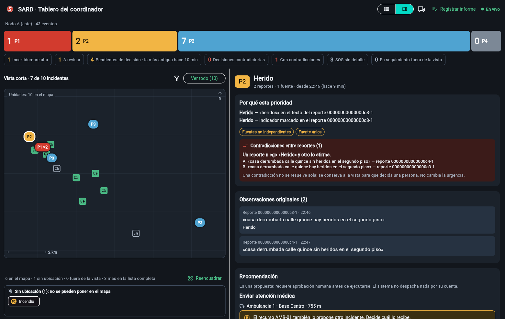

# B6 · El mapa del tablero (10 nov 2026)

Primer bloque tras B5, y la primera mejora del panel donde el coordinador recibe la información. El Reto 6 pide una vista «con evidencia, incertidumbre, **ubicación disponible** y siguiente acción sugerida»; hasta hoy la ubicación sólo se veía como la distancia a los recursos de una recomendación. Todo con datos sintéticos y canales simulados (enunciado §4.7).



> **Lo que no hay que leer de más.** Es un **esquema** sin calles ni teselas (no sale a Internet): da posición relativa y distancias, no sabe qué hay en cada sitio. No se probó con coordinadores. Las cifras de rendimiento son de pruebas de widgets (VM), no del navegador. Detalle en §6.

## 1. Qué se construyó

| Pieza | Qué hace |
|---|---|
| **Nodo** (`incidents.dart`, `queue_view.dart`) | Cada incidente (y `/api/queue`) dice su `locQuality`: la **peor** precisión entre sus reportes localizados. Mostrar la mejor sugeriría una exactitud que el incidente no tiene. |
| **Modelo del tablero** (`models.dart`) | `IncidentRow.locQuality`, `locRadiusMeters` y `locPrecisionLabel`. Un nodo anterior o un código que el tablero no conoce se leen como «desconocida», nunca como una cifra inventada. |
| **Geometría pura** (`map_geometry.dart`, sin Flutter) | Proyección con la misma escala en los dos ejes, encuadre inmutable, agrupación de marcadores, toque, metros→píxeles y barra de escala. |
| **Widget** (`incident_map.dart`) | El mapa: cuadrícula, marcadores, anillos de precisión, grupos, «sin ubicación», aviso de «fuera de la vista». Los marcadores son widgets (no un dibujo): cada uno lo lee un lector de pantalla («P1: Atrapado · Herido. Precisión: unos 50 m.»). |
| **Pantalla** (`dashboard_screen.dart`) | Selector Lista \| Mapa en la barra superior (encima del contenido si hay menos de 700 px). La lista sigue siendo lo que se ve por omisión. |

## 2. Las reglas del mapa y su prueba

| Regla | Por qué | Prueba |
|---|---|---|
| El encuadre **no se mueve solo** con los datos que llegan cada 2 s; lo que cae fuera se avisa (con cuántos son P1) y «Reencuadrar» es a petición | Si se moviera, los marcadores se irían de debajo del dedo de quien está eligiendo | `incident_map_test` (grupo «el encuadre NO se mueve solo»), `dashboard_map_test` con el sondeo real |
| **Nada cambia de tamaño** cuando cambia el estado (aviso, «sin ubicación», grupo abierto) | El encuadre se ajusta al tamaño del lienzo: si éste cambia, todo se mueve | Las zonas de aviso y «sin ubicación» miden siempre lo mismo; el grupo es una ventana sobre el lienzo; hay una prueba por cada uno |
| Lo que **no tiene ubicación no desaparece** | «Sin ocultar casos relevantes» | Se lista aparte y se puede elegir igual, también desde la pantalla |
| Dos incidentes **en el mismo sitio** forman un grupo; un **P1 nunca queda tapado** | Esconder un caso es el error que más cuesta | Propiedad con 50 conjuntos aleatorios: no se pierde ninguno; el resultado no depende del orden de entrada; el grupo se dibuja donde está su miembro más urgente (no se desplaza nada para «separar») |
| La **precisión no se finge** | Un pin nítido sugiere una exactitud que no hay | Anillo sólo si es mayor que el marcador; si no se sabe, no se dibuja uno inventado |
| Muestra **lo cargado y lo dice** | En la vista corta no están los P3/P4 antiguos ni los «SOS sin detalle» | «N en el mapa · K sin ubicación · J fuera de la vista · M más en la lista completa» |

## 3. Pruebas y mutaciones

Pruebas primero en cada capa (rojo antes que verde). **+79 pruebas** (1 448 → **1 527**): nodo 9, modelo 6, geometría 26, widget 26, pantalla 12.

Mutaciones (cambiar una línea del código y ver si alguna prueba lo nota): **67 aplicadas, 66 detectadas**. La que sobrevive es un mutante **equivalente** (filtrar por `members` o por `located` da lo mismo, porque un reporte sin ubicación nunca comparte incidente con uno localizado; lo demuestra una prueba).

| Capa | Mutaciones | Detectadas |
|---|---|---|
| Geometría | 18 | 18 |
| Modelo | 7 | 7 |
| Nodo | 8 | 7 (+1 equivalente) |
| Widget | 26 | 26 |
| Pantalla | 8 | 8 |

**Las mutaciones destaparon huecos en mis propias pruebas** (9 en total), y por eso la tabla de arriba es la vuelta final, no la primera: la prueba de escala estaba hecha a 5° de latitud, donde el coseno vale 0,996 y la corrección ni se nota; ninguna probaba el borde del encuadre, el «más cercano» del toque ni la cifra «5» de la barra de escala; una comprobación comparaba dos cosas que comparten la misma escala, así que un error en ella las movía a las dos por igual; y una prueba (el anillo «no se come los toques») resultó inerte —los anillos se pintan debajo de todos los marcadores, así que no podían quitarles un toque— y se **eliminó** en vez de contarla como cobertura.

## 4. Defectos que encontré en mi propio trabajo

1. El marcador desbordaba su caja por 2,5 px (la prueba de widget lo vio a la primera).
2. **Al aparecer el aviso «fuera de la vista», todos los marcadores se movían**: el aviso le quitaba altura al lienzo y el encuadre se ajusta al tamaño del lienzo. Es la regla de oro de esta app (nada cambia de tamaño ni de sitio cuando cambia el estado), rota por mí; la prueba de estabilidad lo cazó. Arreglo: zonas de altura constante.
3. **La ventana del grupo tapaba su propio marcador**: la colocaba con una estimación de su altura (86 px) y medía 142. Lo reveló una mutación que sobrevivía: mi prueba de «tocar otra vez cierra el grupo» pasaba por una razón falsa (el segundo toque caía sobre un chip de la ventana). Arreglo: se ancla por el borde que toca al marcador, sin estimar la altura.
4. El selector Lista \| Mapa en la barra desbordaba 27 px a 360 px de ancho (lo vieron las pruebas **existentes** de la barra): en pantallas estrechas va encima del contenido.
5. Poner el selector como una fila encima de la lista le quitaba ≈ 50 px de altura y rompió tres pruebas existentes (`ListView` no construye lo que no se ve): se movió a la barra. No adapté las pruebas a perder espacio de lectura.
6. **Un grupo con muchos incidentes («P3 ×12») desbordaba**: lo destapó la medición de rendimiento con 1 000 incidentes. Arreglo: el texto se reduce para caber y pasa a «99+» desde 100. Una mutación (`BoxFit.none`) sobrevivió porque ese texto se pintaba **fuera** de su pastilla sin lanzar ningún error de desbordamiento: la prueba ahora mide la geometría real, no sólo la ausencia de excepción.
7. **Escribí tres piezas que nada usaba** (`hitTest`, `MapFrame.outside` y un constructor `MapFrame.around`): la ventana usa un `GestureDetector` por marcador y el widget calcula lo mismo por su cuenta. El mismo barrido de código muerto que acababa de pasar por el resto del repositorio las encontró; las quité con sus pruebas (30 → 26) y sus mutaciones.
8. **Mi herramienta de mutaciones contaba las omitidas como detectadas** (una mutación cuyo fragmento ya no existía, por un refactor, figuraba como «matada»). La corregí y volví a lanzar lo que se había perdido; las cifras de arriba son sólo las **aplicadas**.

## 4 bis. Verificado en un navegador real

Con un nodo de verdad y el escenario de ejemplo (8 incidentes), en Chrome: el mapa dibuja los 4 incidentes localizados, el incendio sin ubicación queda listado aparte, tocar el P1 lo marca con un aro y abre su detalle, y el árbol de accesibilidad nombra cada marcador. Sin conexión a Internet en ningún momento.

## 5. Rendimiento (pruebas de widgets, no navegador)

| Incidentes cargados | Primer pintado | Reconstrucción (cada 2 s) | Marcadores dibujados |
|---|---|---|---|
| 200 | 226 ms | 33 ms | 124 |
| 1 000 | 100 ms | 31 ms | 238 |
| 3 000 | 144 ms | 35 ms | 295 |

(Incidentes repartidos al azar en 8 × 8 km; los que caen a menos de 14 px se agrupan, por eso hay menos marcadores que incidentes.) El tablero pide hasta 200 filas por página y recarga hasta 1 000.

## 6. Límites (lo que esto no demuestra)

- **Es un esquema, no un mapa.** Sin calles, sin nombres, sin teselas: no ayuda a *llegar*, sólo a ver dónde está cada cosa respecto a las demás. Con teselas precargadas (opción del diseño) habría que empaquetarlas.
- **La ubicación de un incidente es el promedio** de las de sus reportes localizados, y su precisión es la **peor** de ellos: no es el radio real del conjunto.
- **El rendimiento se midió en pruebas de widgets** (VM, sin rasterizar), no en el navegador con 1 000 incidentes.
- **El radio de agrupación (14 px) está elegido a ojo**, no calibrado con ningún conjunto.
- **El mapa no muestra los recursos** (ambulancias, bomberos…) todavía: sale en el B7 con los recursos declarados editables.
- **No se probó con coordinadores.** Lo medido es comportamiento y estabilidad, no si les ahorra tiempo.
- Capturas con datos sintéticos de Manizales; las coordenadas del escenario de ejemplo ocupan ≈ 8 × 5 km.

## 6 bis. La capa de unidades (B7, añadida después)

El mapa dibuja también las **unidades** (ambulancias, bomberos…) que el nodo usa de verdad: cuadradas (los incidentes son redondas), rellenas si están disponibles, huecas si no, y con «!» si hay un conflicto de declaraciones. Van **debajo** de los incidentes (un P1 nunca queda tapado por una ambulancia) y **no capturan toques**. Su conteo («Unidades: N en el mapa · M fuera de la vista») es un rótulo propio sobre el lienzo, para no mezclarlo con el estado de los incidentes ni recortar su cláusula «más en la lista completa». El encuadre sigue fijado por los incidentes: una unidad que cae fuera no lo mueve, se cuenta como «fuera de la vista». Pruebas en `apps/dashboard/test/resources_map_test.dart` (10) y `resources_ui_test.dart`; las mutaciones de la capa (pintarla encima, dibujar lo que cae fuera, los conteos, el estado visual de la unidad, que el rótulo capture toques) se detectaron al final, tras cerrar tres huecos de mis propias pruebas. Capa y panel «Recursos» se miraron en Chrome contra un nodo real. Ver el informe de recursos en el README (B7) y `tool/resources_check.sh`.

## 7. Cómo reproducirlo

```bash
cd apps/dashboard && flutter test test/map_geometry_test.dart test/incident_map_test.dart test/dashboard_map_test.dart test/loc_precision_test.dart
cd apps/node && dart test test/incident_location_test.dart
# con un nodo real y datos de ejemplo
(cd apps/dashboard && flutter build web --no-web-resources-cdn)
(cd apps/node && dart run bin/sard_node.dart --id A --port 8081 --data /tmp/sard-A --web-root ../dashboard/build/web --resources ../../config/recursos.json)
dart run packages/sim/bin/seed_scenario.dart --node http://localhost:8081 --now      # y abrir http://localhost:8081/ → icono del mapa
bash tool/test_all.sh                                                                  # todo (≈ 6 min): 1 887 pruebas con lo que se añadió después (B7 y B8)
```
